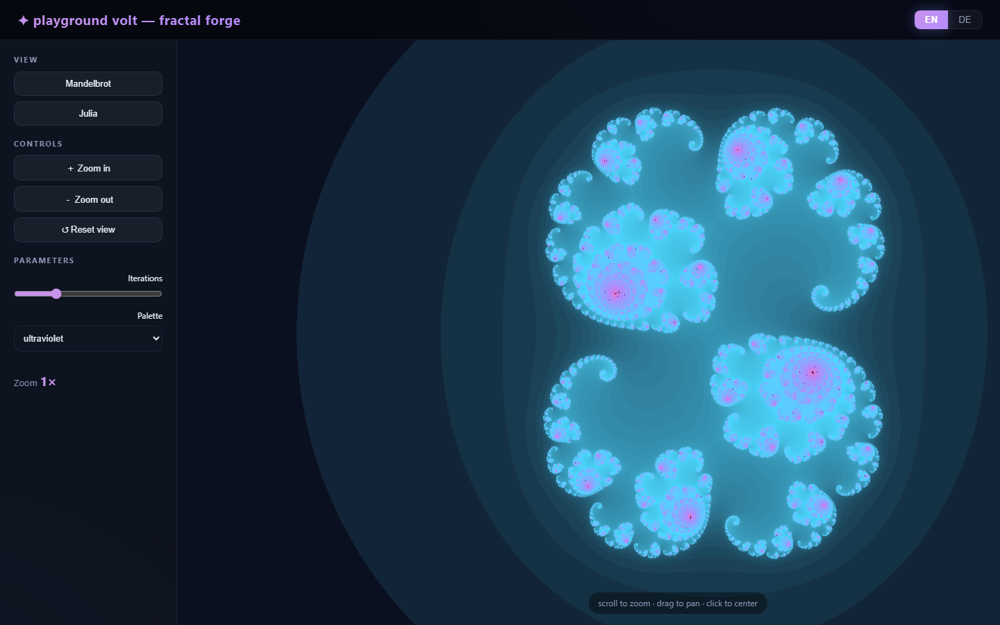
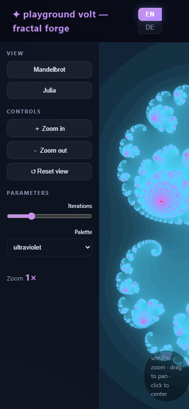

# Playground Volt — Fractal Forge

A real-time Mandelbrot/Julia fractal explorer: smooth zoom, pan, 4 color palettes, up to 800 iterations and a dedicated Julia mode. Pure canvas, zero dependencies.

<div align="center">


**[Live Demo](https://ruslanfridenli.github.io/playground-volt/)** · **[Deutsch ↓](#-deutsch)**

</div>

---

## Screenshots






## Features

- Mandelbrot and Julia set rendering
- Smooth scroll zoom and drag pan
- 4 hand-tuned color palettes
- Up to 800 max iterations
- Click-to-center navigation
- English/German interface

## Local development

```bash
git clone https://github.com/ruslanfridenli/playground-volt.git
cd playground-volt
# open index.html in a browser, or serve statically:
npx serve .
```

No build step, no dependencies — pure static site.

---

## 🇩🇪 Deutsch

### Playground Volt — Fractal Forge

Ein Echtzeit-Mandelbrot-/Julia-Fraktal-Explorer: sanftes Zoomen, Schwenken, 4 Farbpaletten, bis zu 800 Iterationen und ein eigener Julia-Modus. Reines Canvas, keine Abhängigkeiten.

### Funktionen

- Mandelbrot- und Julia-Mengen-Rendering
- Sanftes Scroll-Zoom und Zieh-Schwenken
- 4 handgestimmte Farbpaletten
- Bis zu 800 Iterationen
- Klick-zum-Zentrieren-Navigation
- Englische/deutsche Oberfläche

### Lokale Entwicklung

```bash
git clone https://github.com/ruslanfridenli/playground-volt.git
cd playground-volt
npx serve .
```

Reine statische Seite — kein Build-Schritt, keine Abhängigkeiten.

---

## ☕ Support / Unterstützen

Wenn dir diese Website beim Lernen hilft, würde mir eine Spende sehr viel bedeuten und dabei helfen, sie weiterzuentwickeln. Alternativ kannst du das Projekt mit einem Stern im github repo unterstützen. Vielen Dank!

- Solana: `zQpgZ6nGigww7vYpz3Qqxb1BT44kqS567vFaLTeHagS`
- Ethereum: `0x9c4fE1B2e9a1A9c22312c8296BB088Ca0e8F1B4e`
- Bitcoin: `bc1p2jltk9ya9kyzv35d8kxn7mmg9jqkx66cqtgzqwe75zlr4v9jk4hsv468q7`

---

Made with care. Feedback welcome via issues.
